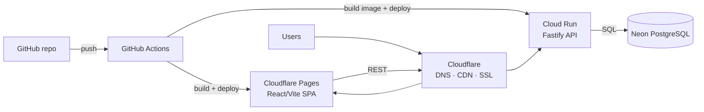

# AccidentesCarabineros

Road-safety (traffic accident) analysis for Carabineros de Chile: normalize the raw
2025 crash Excel datasets into a relational database, expose aggregate read-only
REST endpoints, and visualize them in a dashboard.

## Production architecture

| Layer | Service | Content |
| --- | --- | --- |
| 🟧 Frontend hosting | **Cloudflare Pages** | React 19 + Vite SPA (`frontend/`) |
| 🟦 API | **Google Cloud Run** | Fastify service (`backend/`) — Fastify only, no NestJS, no Express |
| 🟩 Database | **Neon** | PostgreSQL |
| ⚫ CI/CD | **GitHub Actions** | Build, test, image push, deploys |
| 🟧 Edge | **Cloudflare** | DNS, CDN, SSL |



The SPA calls the Fastify API (read-only aggregate endpoints); the API queries
Neon PostgreSQL. The backend container follows the Cloud Run contract: it
listens on `0.0.0.0` and the injected `PORT` (default `8080`).

## Repository layout

- `frontend/` — Vite + React + Tailwind v4 dashboard. **Currently renders
  synthetic fixtures** (`frontend/src/data/`); the join point for real data is
  `frontend/src/lib/data.ts`.
- `backend/` — Fastify API + Excel ingestion pipeline (TypeScript).
- `Siniestros_2025(1).xlsx`, `Personas_2025(1).xlsx`, `Vehiculos_2025(1).xlsx` —
  raw source datasets at the repo root. Local-only inputs: never committed and
  never baked into Docker images; they are mounted read-only when the importer
  runs.
- `odd/tasks/` — ODD feature plans and progress evidence.

## Data pipeline (planned + in progress)

Tracked in `odd/tasks/backend-production-stack.md`:

- Normalized PostgreSQL schema (MER) documented in `backend/docs/MER.md`.
- Import pipeline standardizing the three Excels: column rename map, value
  normalization (trim → uppercase → strip accents → remove dots, matching the
  historical `app.py` criteria), catalog upserts, orphan/invalid-row reporting,
  and count reconciliation against the sources.
- Production dataset delivery (GCS bucket vs. upload endpoint) is still an open
  decision; the importer reads a configured directory behind an adapter
  interface.

## Local development

Frontend (mock data):

```bash
cd frontend && npm install && npm run dev
```

Backend:

```bash
cd backend && npm install
npm run dev    # watch mode
npm run build  # tsc -> dist/
npm start      # node dist/server.js; honors PORT (default 8080)
```

Smoke check: `curl http://localhost:8080/health` → `{ "status": "ok" }`.
`GET /api/dashboard` requires `Authorization: Bearer $UUID_CONNECTION`
(`/health` stays public):

```bash
curl -H "Authorization: Bearer $UUID_CONNECTION" http://localhost:8080/api/dashboard
```

## Dashboard API connection (local)

The frontend reads `GET /api/dashboard` with a basic Bearer request barrier.
It is a lightweight barrier, **not** user authentication: `VITE_UUID_CONNECTION`
is embedded in the static bundle and is intentionally visible (accepted
limitation). Development and production must use different values.

| Variable | Side | Where it lives locally |
|---|---|---|
| `UUID_CONNECTION` | backend runtime (expected Bearer) | repo-root `.env` (compose interpolation; ignored) |
| `VITE_API_BASE_URL` | frontend build (API origin) | root `.env` for compose / `frontend/.env.local` for Vite dev |
| `VITE_UUID_CONNECTION` | frontend build (Bearer sent) | compose passes `UUID_CONNECTION` through; `frontend/.env.local` for Vite dev |
| `CORS_ALLOWED_ORIGINS` | backend runtime | root `.env`; defaults to `http://localhost:3200,http://localhost:5173` |

```bash
cp .env.example .env                      # then set UUID_CONNECTION=...
cp frontend/.env.example frontend/.env.local  # same token, for `npm run dev`
```

Never write real token values into Git, Dockerfiles, docs, or logs.
Future production mapping (documentation only — not applied): Cloudflare Pages
build gets `VITE_API_BASE_URL` + `VITE_UUID_CONNECTION` (public build inputs);
Cloud Run gets `UUID_CONNECTION` from Secret Manager, plus the deployed Pages
origin in `CORS_ALLOWED_ORIGINS`.

## Local Docker stack

`compose.yaml` runs the production-like flow locally: PostgreSQL (standing in
for Neon), the Fastify backend image (runs `prisma migrate deploy` at startup),
an nginx-served SPA frontend, and a one-shot importer. Cloud Run / Cloudflare
Pages / Neon remain the production targets.

```bash
docker compose up -d --build   # postgres -> backend (migrates) -> frontend
docker compose run --rm importer   # loads the three root Excels, reconciles counts
docker compose down -v             # teardown; -v drops the DB volume
```

- Frontend: <http://localhost:3200> · API: <http://localhost:8080/health>.
- The backend image builds from the **repo root** context
  (`docker build -f backend/Dockerfile .`) because it ships the canonical
  catalog `frontend/src/data/oversio-identifiers.json`; the root `.dockerignore`
  keeps datasets, `node_modules`, and `.env` out of every image.
- Postgres is internal-only with throwaway local credentials
  (`accidentes`/`accidentes_dev`); production injects a real Neon
  `DATABASE_NEON_URL` for API traffic and `DIRECT_URL` for Prisma migrations.
- The importer reuses the backend image and bind-mounts the root `*.xlsx`
  datasets read-only, asserting 73,081 / 148,252 / 130,234 rows; it is safe to
  re-run (idempotent).

## Current status

- Frontend dashboard shell, filters, and charts: connected to the real
  `GET /api/dashboard` API (Bearer barrier) — synthetic fixtures were removed.
- Backend: Fastify bootstrap with health check, Prisma migrations, Excel
  importer, dashboard read endpoint, Bearer/CORS guard, and the local Docker
  stack are in place; the deploy slice (Cloud Run/Pages/Neon wiring) is the
  next task in the ODD plan.
