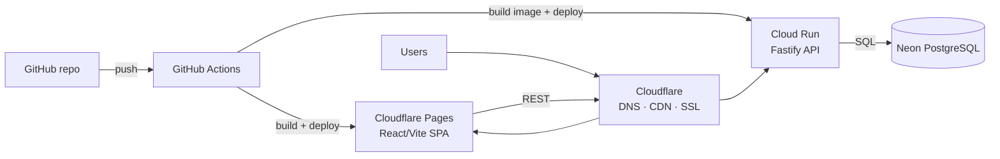

# AccidentesCarabineros

Road-safety (traffic accident) analysis for Carabineros de Chile: normalize the raw
2025 crash Excel datasets into a relational database, expose aggregate read-only
REST endpoints, and visualize them in a dashboard.

## Production architecture

| Layer | Service | Content |
| --- | --- | --- |
| 🟧 Frontend hosting | **Cloudflare Pages** | React 19 + Vite SPA (`frontend/`) |
| 🟦 API | **Google Cloud Run** | Fastify service (`backend/`) — Fastify only, no NestJS, no Express |
| 🟩 Database | **Neon** | PostgreSQL |
| ⚫ CI/CD | **GitHub Actions** | Build, test, image push, deploys |
| 🟧 Edge | **Cloudflare** | DNS, CDN, SSL |



The SPA calls the Fastify API (read-only aggregate endpoints); the API queries
Neon PostgreSQL. The backend container follows the Cloud Run contract: it
listens on `0.0.0.0` and the injected `PORT` (default `8080`).

## Repository layout

- `frontend/` — Vite + React + Tailwind v4 dashboard. **Currently renders
  synthetic fixtures** (`frontend/src/data/`); the join point for real data is
  `frontend/src/lib/data.ts`.
- `backend/` — Fastify API + Excel ingestion pipeline (TypeScript).
- `Siniestros_2025(1).xlsx`, `Personas_2025(1).xlsx`, `Vehiculos_2025(1).xlsx` —
  raw source datasets at the repo root. Local-only inputs: never committed and
  never baked into Docker images; they are mounted read-only when the importer
  runs.
- `odd/tasks/` — ODD feature plans and progress evidence.

## Data pipeline (planned + in progress)

Tracked in `odd/tasks/backend-production-stack.md`:

- Normalized PostgreSQL schema (MER) documented in `backend/docs/MER.md`.
- Import pipeline standardizing the three Excels: column rename map, value
  normalization (trim → uppercase → strip accents → remove dots, matching the
  historical `app.py` criteria), catalog upserts, orphan/invalid-row reporting,
  and count reconciliation against the sources.
- Production dataset delivery (GCS bucket vs. upload endpoint) is still an open
  decision; the importer reads a configured directory behind an adapter
  interface.

## Local development

Frontend (mock data):

```bash
cd frontend && npm install && npm run dev
```

Backend:

```bash
cd backend && npm install
npm run dev    # watch mode
npm run build  # tsc -> dist/
npm start      # node dist/server.js; honors PORT (default 8080)
```

Smoke check: `curl http://localhost:8080/health` → `{ "status": "ok" }`.

A production-like local stack (Docker Compose with PostgreSQL + Fastify + static
frontend) is being added in task T6 of the ODD plan; until it exists, the
backend runs against no database.

## Current status

- Frontend dashboard shell, filters, and charts: done (synthetic fixtures).
- Backend: Fastify bootstrap with health check; ingestion, MER migrations,
  Docker, and dashboard endpoints are the next tasks in the ODD plan.
