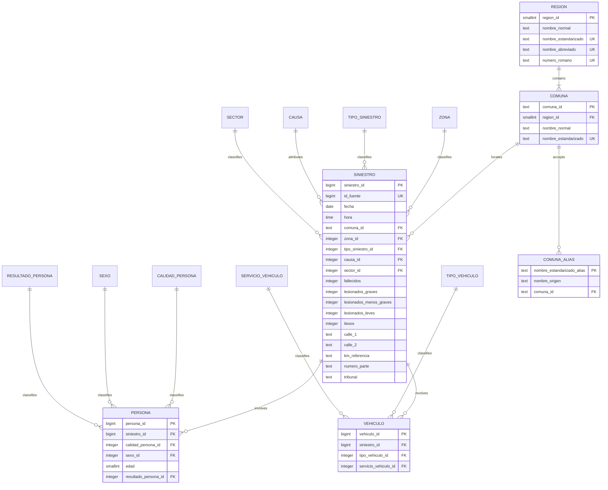

# Accidentes de tránsito: modelo entidad-relación

Este documento define el modelo relacional propuesto para importar los tres Excel de 2025 a PostgreSQL. El catálogo `frontend/src/data/oversio-identifiers.json` es la fuente canónica de regiones y comunas; el importador debe resolver los nombres de los Excel contra ese catálogo y guardar sus identificadores, sin mantener una segunda lista territorial independiente.

> **Estado:** diseño de T3 para implementar en el schema y las migraciones de T4. No describe tablas ya desplegadas.

## 1. Vista general

The diagram omits descriptive columns from lookup tables for readability. Each lookup table has its own primary key plus `nombre_normal` and `nombre_estandarizado` values as described below.

## 2. Territorial catalog and normalization

### Region

Seed `region` from each object in `regions` in the canonical JSON:

| Database column | JSON source | Rule |
|---|---|---|
| `region_id` | `number` | Cast the JSON numeric string to `SMALLINT`; values identify the Chilean region. |
| `nombre_normal` | `name` | Keep the catalog spelling, accents, and spaces for readable display. |
| `nombre_estandarizado` | Derived from `name` | Store the normalized comparison key; unique. |
| `nombre_abreviado` | `abbreviation` | Preserve the catalog abbreviation, such as `RM`; unique. |
| `numero_romano` | `romanNumber` | Preserve the catalog code, such as `XIII`; unique. |

`number`, `romanNumber`, and `abbreviation` are all source attributes; `region_id` is the database identifier sourced from `number`. Do not infer a region from the Excel `ZONA` value.

### Commune

Seed `comuna` from every commune nested under its region in the same JSON:

| Database column | JSON source | Rule |
|---|---|---|
| `comuna_id` | `identifier` | Stable text identifier, for example `XIII-9`; primary key. |
| `region_id` | Containing region's `number` | Foreign key to `region.region_id`. |
| `nombre_normal` | `name` | Keep the catalog spelling, accents, and spaces for display. |
| `nombre_estandarizado` | Derived from `name` | Store the normalized comparison key; unique. |

The four approved Metropolitan additions are:

| `comuna_id` | `nombre_normal` | `region_id` |
|---|---|---:|
| `XIII-49` | El Monte | 13 |
| `XIII-50` | Isla de Maipo | 13 |
| `XIII-51` | Padre Hurtado | 13 |
| `XIII-52` | Peñaflor | 13 |

These identifiers extend the existing Metropolitan sequence (`XIII-1` … `XIII-48`). They are project catalog identifiers, not Chilean statistical codes. The corresponding entries were added to `oversio-identifiers.json` as part of T3.

### Standardization key

Apply the same function to both source labels and catalog labels:

1. Trim leading and trailing whitespace.
2. Unicode-normalize with NFKD and remove combining marks (accents/diacritics).
3. Uppercase.
4. Keep only ASCII letters `A–Z` and digits `0–9`; this removes spaces and punctuation.

Examples:

| Input | Standardized key |
|---|---|
| `Región Metropolitana de Santiago` | `REGIONMETROPOLITANADESANTIAGO` |
| `Alto Biobío` | `ALTOBIOBIO` |
| `ALTO BIO-BIO` | `ALTOBIOBIO` |

The standardized field is derived and must not be independently edited. Keep `nombre_normal` as the readable canonical label; facts reference catalog IDs, not copied commune or region names. Re-run uniqueness checks whenever the JSON catalog changes.

### Commune aliases

Most source labels resolve by standardized key. A few are spelling/wording differences and need explicit aliases rather than fuzzy matching:

| Excel label | Canonical commune | `comuna_id` | Resolution |
|---|---|---|---|
| `AYSEN` | Aisén | `XI-3` | Explicit alias (`Y`/`I` spelling differs). |
| `CABO DE HORNOS` | Cabo de Hornos (Ex Navarino) | `XII-5` | Explicit alias (source omits the parenthetical). |
| `COYHAIQUE` | Coihaique | `XI-1` | Explicit alias (`Y`/`I` spelling differs). |
| `LLAYLLAY` | Llaillay | `V-31` | Explicit alias (`Y`/`I` spelling differs). |
| `SAN PEDRO ATACAMA` | San Pedro de Atacama | `II-7` | Explicit alias (source omits `de`). |

The agreed normalizer resolves `ALTO BIO-BIO` to `Alto Biobío` and `O"HIGGINS` to `O'Higgins` without aliases. Store explicit alternate normalized keys in `comuna_alias` (`nombre_estandarizado_alias` primary key, `comuna_id` foreign key, and optional `nombre_origen` for audit). Reject any alias that collides with a canonical key or another alias. Never use approximate/fuzzy matching for a production foreign key.

The source contains 340 distinct `COMUNA` labels. With the four catalog additions and five explicit spelling aliases, every source commune resolves to a canonical `comuna_id`. The current catalog's standardized commune keys are unique; preserve this as an import/seed validation.

### Region and `ZONA` are different concepts

`ZONA` has 16 observed values but is not a reliable region key: several zone labels occur with communes belonging to more than one region in the territorial catalog. For example, `ZONA DE ATACAMA` occurs with communes in regions III and IV, and `ZONA METROPOLITANA` occurs with communes in VI and XIII. Therefore:

- `region` is seeded from the JSON and reached through `siniestro.comuna_id → comuna.region_id`.
- `zona` is a separate lookup referenced by `siniestro.zona_id`.
- Do not store `region_id` redundantly in `siniestro` or derive it from `ZONA`.

## 3. Core entities and Excel mapping

### `siniestro`

One row per source accident. `siniestro_id` is an internal generated primary key; `id_fuente` preserves the Excel `ID` used to link the two detail workbooks.

| Excel column | Database column | PostgreSQL type / constraint | Mapping notes |
|---|---|---|---|
| `ID` | `id_fuente` | `BIGINT NOT NULL` | Unique in the 2025 Siniestros file; referenced during child-row resolution. Scope uniqueness by source period if multiple years are retained together. |
| `FECHA` | `fecha` | `DATE NOT NULL` | Excel serial dates cover 2025-01-01 through 2025-12-31. |
| `MES` | — | — | Derive month from `fecha`; validate source `MES` during import, do not persist a duplicate. All three workbooks agree with `FECHA`. |
| `HORA` | `hora` | `TIME NOT NULL` | Convert the Excel numeric time fraction to a PostgreSQL time. |
| `ZONA` | `zona_id` | `INTEGER NOT NULL FK` | Resolve to `zona` lookup (16 observed labels); distinct from region. |
| `COMUNA` | `comuna_id` | `TEXT NOT NULL FK` | Normalize/alias-match against the canonical JSON-derived commune catalog. |
| `TIPO` | `tipo_siniestro_id` | `INTEGER NOT NULL FK` | Resolve to `tipo_siniestro` lookup (15 values). Not the vehicle type. |
| `CAUSA` | `causa_id` | `INTEGER NOT NULL FK` | Resolve to `causa` lookup (70 values). |
| `SECTOR` | `sector_id` | `INTEGER NOT NULL FK` | Resolve to `sector` lookup (`RURAL`, `URBANO`; 2 values). |
| `FALLECIDO` | `fallecidos` | `INTEGER NOT NULL CHECK (fallecidos >= 0)` | Count. |
| `GRAVE` | `lesionados_graves` | `INTEGER NOT NULL CHECK (lesionados_graves >= 0)` | Count. |
| `M_GRAVE` | `lesionados_menos_graves` | `INTEGER NOT NULL CHECK (lesionados_menos_graves >= 0)` | Count. |
| `LEVE` | `lesionados_leves` | `INTEGER NOT NULL CHECK (lesionados_leves >= 0)` | Count. |
| `ILESO` | `ilesos` | `INTEGER NOT NULL CHECK (ilesos >= 0)` | Count. |
| `CALLE_1` | `calle_1` | `TEXT NULL` | Preserve source text; 2 rows are blank. |
| `CALLE_2` | `calle_2` | `TEXT NULL` | Preserve source text; 37,772 rows are blank. |
| `KM` | `km_referencia` | `TEXT NULL` | 36,712 populated values; source cells mix numeric/text storage and include fractional values. Preserve the source representation until its semantics and formatting are confirmed. |
| `PARTE` | `numero_parte` | `TEXT NOT NULL` | Treat as an identifier, not a quantity, even though Excel stores it numerically. |
| `TRIBUNAL` | `tribunal` | `TEXT NOT NULL` | Preserve source label; 502 distinct values observed. |

### `persona`

One row per person record in Personas. The source has no person-specific identifier, so `persona_id` is a generated primary key. `ID` resolves to the parent siniestro; it is intentionally repeated across people in the same accident.

| Excel column | Database column | PostgreSQL type / constraint | Mapping notes |
|---|---|---|---|
| `ID` | `siniestro_id` | `BIGINT NOT NULL FK` | Resolve through `siniestro.id_fuente`; do not use as `persona_id`. |
| `FECHA`, `MES`, `HORA`, `COMUNA`, `ZONA` | — | — | Repeated event fields. Validate against the matched siniestro; do not store again. All compared rows matched the parent values. |
| `CALIDAD` | `calidad_persona_id` | `INTEGER NOT NULL FK` | Lookup (4 observed categories). |
| `SEXO` | `sexo_id` | `INTEGER NOT NULL FK` | Lookup (3 observed categories, including `SE IGNORA`); do not coerce to Boolean. |
| `EDAD` | `edad` | `SMALLINT NULL CHECK (edad BETWEEN 1 AND 120)` | 23,918 values are blank; populated values range from 1 to 96. |
| `RESULTADO` | `resultado_persona_id` | `INTEGER NOT NULL FK` | Lookup (5 observed categories). |

### `vehiculo`

One row per vehicle record in Vehiculos. The source has no vehicle-specific identifier, so `vehiculo_id` is a generated primary key. `ID` is the parent siniestro reference.

| Excel column | Database column | PostgreSQL type / constraint | Mapping notes |
|---|---|---|---|
| `ID` | `siniestro_id` | `BIGINT NOT NULL FK` | Resolve through `siniestro.id_fuente`; do not use as `vehiculo_id`. |
| `FECHA`, `MES`, `HORA`, `COMUNA`, `ZONA` | — | — | Repeated event fields. Validate against the matched siniestro; do not store again. All compared rows matched the parent values. |
| `TIPO` | `tipo_vehiculo_id` | `INTEGER NOT NULL FK` | Lookup (38 observed categories); separate from `tipo_siniestro`. |
| `SERVICIO` | `servicio_vehiculo_id` | `INTEGER NOT NULL FK` | Lookup (22 observed categories). |

### Lookup tables

Each lookup has a generated integer primary key, `nombre_normal`, and a unique `nombre_estandarizado` calculated with the same normalizer. Seed values from the source categories, preserving `nombre_normal` for display.

| Lookup table | Source column | Distinct observed values |
|---|---|---:|
| `zona` | Siniestros `ZONA` | 16 |
| `tipo_siniestro` | Siniestros `TIPO` | 15 |
| `causa` | Siniestros `CAUSA` | 70 |
| `sector` | Siniestros `SECTOR` | 2 |
| `calidad_persona` | Personas `CALIDAD` | 4 |
| `sexo` | Personas `SEXO` | 3 |
| `resultado_persona` | Personas `RESULTADO` | 5 |
| `tipo_vehiculo` | Vehiculos `TIPO` | 38 |
| `servicio_vehiculo` | Vehiculos `SERVICIO` | 22 |

Do not share a lookup merely because source columns have the same name: `Siniestros.TIPO` and `Vehiculos.TIPO` have different domains and meanings.

## 4. Cardinalities and observed coverage

| Relationship | Cardinality | Evidence |
|---|---|---|
| `region` → `comuna` | 1:N | JSON nests each commune under exactly one region. |
| `comuna` → `siniestro` | 1:N | Siniestros carries one `COMUNA`; region is reached through the commune. |
| `zona` → `siniestro` | 1:N | 16 distinct source zones; zone is independent of region. |
| `siniestro` → `persona` | 1:N | 73,081 unique source accident IDs; 148,252 person rows; up to 95 persons per source ID. |
| `siniestro` → `vehiculo` | 1:N | 130,234 vehicle rows across 73,079 source IDs; up to 18 vehicles per source ID. |

Source row counts: 73,081 Siniestros, 148,252 Personas, and 130,234 Vehiculos. All source IDs are populated; `ID` is unique in Siniestros and repeats in child files. Two siniestros have no vehicle rows; preserve those siniestros and report the absence rather than rejecting them.

## 5. Integrity, 3NF, and operational constraints

### Normalization rationale

- **1NF:** each row represents one siniestro/persona/vehiculo; counts and labels are atomic.
- **2NF:** each table has a single-column primary key; non-key attributes describe that row's entity.
- **3NF:** region descriptions live only in `region`; commune-to-region belongs in `comuna`; a siniestro references one commune and zone; person/vehicle rows reference their siniestro and do not duplicate event date, time, commune, or zone; `MES` is derived from `fecha`.
- `nombre_estandarizado` is a deterministic key derived from the normal catalog name. It must be generated/maintained by one implementation, uniquely constrained, and never independently edited. The readable canonical value remains in `nombre_normal`.
- Category descriptions belong to lookup tables, so fact rows store FKs instead of repeating standardized labels.
- Dashboard aggregates (monthly counts, territory rankings) should be queries/views or a separately justified read model, not duplicated columns in the OLTP facts.

### Constraints and deletes

- Every table has a primary key. Canonical region IDs come from JSON `number`; commune IDs come from JSON `identifier`; source Excel IDs are not child-row primary keys.
- Add unique constraints for region `numero_romano`, `nombre_abreviado`, and `nombre_estandarizado`; for commune `comuna_id` and `nombre_estandarizado`; for each lookup's standardized name; and for `siniestro.id_fuente` in the current single-period load. If multiple years are retained together, scope source-ID uniqueness by import period/batch before loading them.
- All FKs are `NOT NULL` for required source relationships and indexed. Region/commune/lookup references use `ON DELETE RESTRICT`; dependent `persona.siniestro_id` and `vehiculo.siniestro_id` use `ON DELETE CASCADE` so child rows cannot outlive their parent.
- Count columns use `CHECK (value >= 0)`. Age is nullable and constrained to the documented business range. Lookup rows are seeded from normalized distinct values, and aliases must not collide with canonical standardized keys.
- Store import lifecycle timestamps in import metadata if/when an import-batch table is introduced; do not present ingestion timestamps as accident event times.

### Indexes

- Unique indexes back every primary/alternate key above.
- Index each FK used for joins: `comuna.region_id`, `siniestro.comuna_id`, `siniestro.zona_id`, `siniestro.tipo_siniestro_id`, `siniestro.causa_id`, `siniestro.sector_id`, person/vehicle catalog FKs, and both child `siniestro_id` FKs.
- Add `siniestro.fecha` for period filters and consider `(comuna_id, fecha)` for commune/time dashboard queries. Final composite indexes should follow measured API queries.

### Import validation

1. Seed/validate regions and communes from the JSON; assert unique normalized keys and IDs.
2. Normalize Excel labels using the same function; resolve canonical keys, then explicit aliases; reject unresolved labels rather than fuzzy-match.
3. Validate `MES` against the month of `FECHA`; validate repeated person/vehicle event fields against the parent siniestro.
4. Reject negative/non-integer injury counts, invalid dates/times, and ages outside the allowed range; record the source filename and row number in the import error report.
5. Reconcile inserted source rows: 73,081 / 148,252 / 130,234 for the current workbooks; report 2 siniestros without vehicle rows as valid coverage gaps.
6. Apply schema changes with reversible PostgreSQL migrations; test them on a fresh local database before Neon deployment.

## 6. Explicit non-goals

- No `region` field is read from these Excel files; region is resolved from the canonical commune catalog.
- `ZONA` is not a region alias and must not be substituted for `region_id`.
- The dashboard's current synthetic fixtures remain unchanged; API wiring is a later task.
- `KM` semantics and geocoding, and the production Excel delivery method (GCS vs upload), remain separate decisions.
